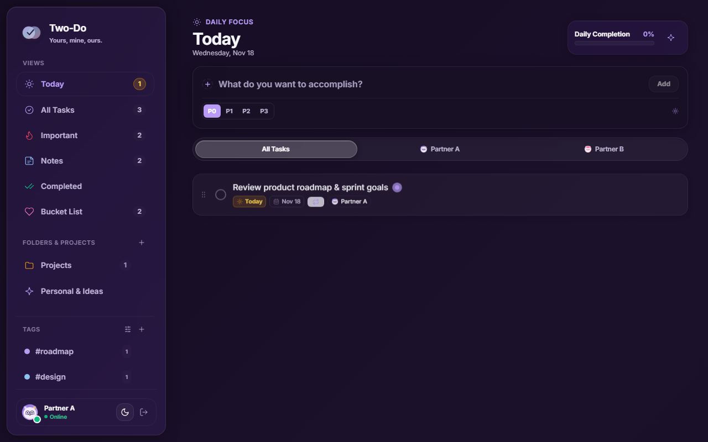
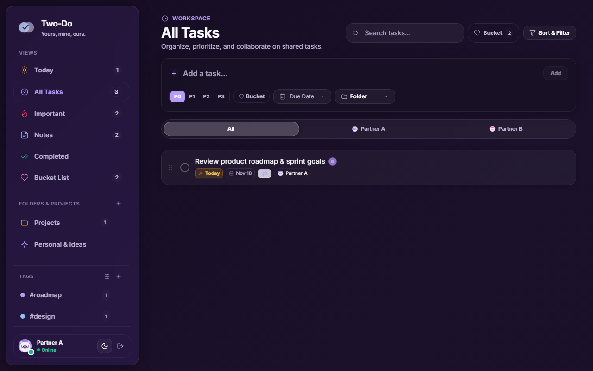
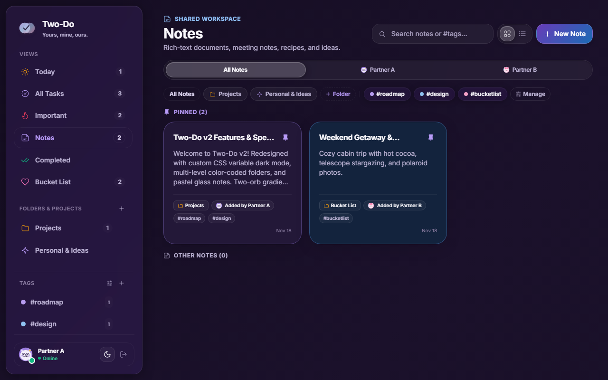

# Two-Do

A private task and notes workspace for two people. Tasks and rich-text notes live side by side, each item records who created it, and the database only lets the two allow-listed accounts read or write anything.

**Live:** https://krrish41.github.io/two-do/ (sign-in is restricted to the two authorised accounts, so visitors cannot log in; see [Demo mode](#demo-mode) to explore the app locally without any account.)

| Today | All tasks | Notes |
| :---: | :---: | :---: |
|  |  |  |

*Screenshots are taken in demo mode with generated sample data.*

## Features

**Tasks**
- Subtasks, four priority levels, due dates, folders and tags
- "My Day" planner and a shared "Bucket List"
- Drag-and-drop reordering (`@dnd-kit`)
- A recurrence rule (daily, weekly, monthly) can be set on a task and is shown with an icon

**Notes**
- Rich-text editor (Tiptap): headings, lists, checklists, blockquotes, code, highlights
- Colour-coded notes, nested folders, tags and pinning

**Two-person model**
- Every task and note records its creator; filter tabs switch between All, Partner A and Partner B
- Per-user accent colour and avatar
- Soft delete with a Recycle Bin (restore or permanently delete)

**Other**
- Optimistic UI updates through Zustand stores
- Light and dark themes
- Scheduled GitHub Action that pings the database every 3 days so a free-tier Supabase project does not pause

## Tech stack

| Area | Choice |
| :--- | :--- |
| UI | React 18, TypeScript, Vite 6 |
| Styling and motion | Tailwind CSS 3.4, Framer Motion |
| State | Zustand 5 (auth, tasks, notes, filters, theme stores) |
| Routing | React Router 7 with `HashRouter` (required for static hosting on GitHub Pages) |
| Editor and drag-and-drop | Tiptap 2, `@dnd-kit` |
| Backend | Supabase: PostgreSQL, Auth, Row Level Security |
| CI/CD | GitHub Actions, GitHub Pages |

## How access control works

- All tables have Row Level Security enabled. Policies call a `SECURITY DEFINER` function, `is_authorized()`, which checks the caller's id against the `authorized_users` table.
- An unauthenticated or non-allow-listed request receives an empty result instead of data.
- The Supabase `anon` key is shipped in the client bundle by design; it is a public identifier and grants nothing without a matching RLS policy.
- Recommended: also disable public sign-ups in Supabase Authentication settings.

## Getting started

### Demo mode

Without Supabase credentials the app starts in demo mode with in-memory sample data and two demo users (Partner A and Partner B). Nothing is persisted.

```bash
git clone https://github.com/Krrish41/two-do.git
cd two-do
npm install
npm run dev        # http://localhost:5173
```

### Run against your own Supabase project

1. Create a Supabase project and two users under Authentication > Users. Copy each user's **User UID**.
2. In the SQL editor, run the files in `supabase/migrations/` in order. Before running `0003_seed_authorized_users.sql`, replace the two placeholder UUIDs and the display names with your own.
3. Create `.env` in the project root:
   ```env
   VITE_SUPABASE_URL=https://<your-project-ref>.supabase.co
   VITE_SUPABASE_ANON_KEY=<your-anon-key>
   ```
4. `npm run dev`

Other scripts: `npm run build` (type-check and production build into `dist/`) and `npm run preview`.

### Database migrations

| File | Purpose |
| :--- | :--- |
| `0001_init_schema.sql` | Core tables: authorized users, folders, tags, tasks, notes, note-tag links |
| `0002_rls_policies.sql` | Row Level Security policies and the `is_authorized()` function |
| `0003_seed_authorized_users.sql` | Allow-list seed (template: add your own user IDs) |
| `0004_v2_features.sql` | Folder icons and colours, task sorting |
| `0005_v3_consistency.sql` | Folder slugs and integrity fixes |
| `0006_v4_tasks_soft_delete.sql` | `deleted_at` columns for the Recycle Bin |

## Project structure

```text
.github/workflows/   deploy.yml (build and publish to Pages), supabase-keepalive.yml
docs/screenshots/    images used in this README
src/
  components/        common, glass (UI primitives), icons, layout, notes, tasks
  constants/         palette, priority and navigation constants
  hooks/             useAuth, useRealtimeSync
  lib/               Supabase client, generated DB types, utilities
  pages/             Today, Tasks, Notes, RecycleBin, Login, Menu
  stores/            Zustand stores: auth, task, note, filter/sort, theme
supabase/migrations/ ordered SQL migrations
```

## Deployment

Pushing to `main` runs `.github/workflows/deploy.yml`: install with `npm ci`, build with `VITE_SUPABASE_URL` and `VITE_SUPABASE_ANON_KEY` taken from repository secrets, then publish `dist/` to GitHub Pages.

## Known limitations

- Recurring tasks store a rule but do not yet create the next occurrence when completed.
- A Supabase Realtime hook (`useRealtimeSync`) exists but is not currently mounted, so changes made on one device appear on another after a reload or refetch, not live.
- No automated tests; CI only type-checks and builds.
- No keyboard shortcuts.

## Licence

No open-source licence is attached; all rights reserved unless one is added.